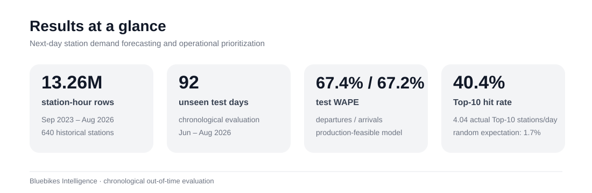
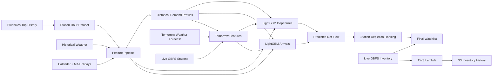

# Bluebikes Intelligence

**Next-day station demand forecasting and operational prioritization for Boston's Bluebikes network.**

Bluebikes Intelligence forecasts hourly bike departures and arrivals for every active station, converts those forecasts into expected net bike depletion, and produces a ranked next-day watchlist enriched with live inventory context.

> **Business question:** Which stations are expected to experience the greatest bike depletion tomorrow, and when should operations pay the most attention?

The system does **not** claim that a station will stock out or that a truck must be dispatched. Trip-based net depletion is an operational prioritization signal, not a confirmed inventory outcome.



## Results

The production-feasible model uses only features available before the forecast day: calendar, Massachusetts/federal holidays, weather, and frozen historical station demand profiles.

| Model | Departures MAE | Departures WAPE | Arrivals MAE | Arrivals WAPE |
|---|---:|---:|---:|---:|
| Frozen historical profile baseline | 0.860 | 70.0% | 0.859 | 70.1% |
| LightGBM production model | **0.828** | **67.4%** | **0.824** | **67.2%** |

Across **92 unseen test days**, the predicted daily Top-10 watchlist captured:

- **4.04 actual Top-10 depletion stations per day on average**
- **40.4% average Top-10 hit rate**
- **40.0% median Top-10 hit rate**
- **1.7% random expected Top-10 hit rate**

The ranking metric evaluates the system the way an operations team would use it: as a prioritized list, not just a forecast table.

## System

```text
3 years of Bluebikes trips
        ↓
station-hour departures / arrivals
        ↓
calendar + holidays + weather
        ↓
historical station demand profiles
        ↓
LightGBM departure + arrival forecasts
        ↓
predicted net bike flow
        ↓
daily cumulative depletion ranking
        ↓
live bike / dock context
        ↓
next-day operational watchlist
```

### Data

Historical forecasting data covers approximately **Sep 2023-Aug 2026**:

- **13,260,534 station-hour rows**
- **640 historical station IDs**
- hourly departures and arrivals
- zero-demand station-hours retained
- hourly temperature and precipitation
- calendar, weekend, and Massachusetts holiday features

Raw and generated datasets are excluded from Git because of size.

### Production feature design

A research model used recent-demand lags from the prior day and prior week and achieved slightly better offline performance.

Those lagged trip counts are not available with enough freshness from the public Bluebikes trip archive for a reliable next-day production run.

The final model therefore uses:

```text
hour / weekday / month
weekend / holiday
weather
historical station demand profile
```

New stations without station-specific history fall back to a network weekday/hour profile.

This preserves nearly all of the research-model performance while keeping the deployed feature set realistic.

## Architecture



The AWS collector stores GBFS station-status snapshots every 10 minutes using EventBridge, Lambda, and S3. That live inventory history is complementary infrastructure for future inventory-aware modeling.

## Evaluation design

Evaluation is chronological rather than random:

```text
historical profile: through Aug 31, 2025
training:           Sep 2025-Feb 2026
validation:         Mar-May 2026
test:               Jun-Aug 2026
```

Primary forecast metrics:

- **MAE** — average absolute trip-count error per station-hour
- **WAPE** — total absolute error relative to total actual demand

Operational evaluation converts hourly forecasts into cumulative daily net depletion and compares the predicted Top-10 stations with the actual Top-10 stations on each unseen test day.

## Run locally

Install dependencies:

```bash
pip install -r requirements.txt
```

Build the historical dataset and features:

```bash
python src/ingestion/download_trips.py
python -m src.forecasting.build_hourly_dataset
python -m src.forecasting.download_weather
python -m src.forecasting.build_features
python -m src.forecasting.build_demand_profile
```

Evaluate the production-feasible model:

```bash
python -m src.forecasting.production_model
```

Generate tomorrow's forecast and watchlist:

```bash
python -m src.forecasting.run_tomorrow
```

That command:

1. downloads tomorrow's Boston weather forecast,
2. maps active GBFS stations to historical station IDs,
3. predicts hourly departures and arrivals,
4. ranks stations by expected cumulative depletion,
5. attaches current live bike and dock inventory.

Generated files are written to `data/processed/`.

## Repository structure

```text
bluebikes-intelligence/
├── README.md
├── PROJECT_PROBLEM.md
├── requirements.txt
├── assets/
│   └── results_summary.svg
├── docs/
│   ├── cloud_inventory_pipeline.md
│   ├── modeling_decisions.md
│   └── technical_walkthrough.md
├── infrastructure/
│   └── lambda/
└── src/
    ├── ingestion/
    ├── data_pipeline/
    ├── forecasting/
    └── models/
```

The main next-day workflow lives in `src/forecasting/`. Earlier stockout-risk experiments and the live inventory collector are preserved as complementary work rather than hidden.

## Important boundaries

- Predicted trip net flow is **not** confirmed inventory change.
- Operator rebalancing is not visible in customer trip history.
- Current live inventory is context, not tomorrow morning's starting inventory.
- Historical backtests use observed weather; the live workflow uses forecast weather.
- The watchlist prioritizes monitoring; it does not optimize truck routing.
- Random ranking is a sanity-check comparator, not a substitute for operational baseline analysis.

## Documentation

For deeper technical detail:

- `PROJECT_PROBLEM.md` — business problem, target, evaluation, and V1 scope
- `docs/modeling_decisions.md` — leakage boundaries, lag-feature decision, cold starts, metrics, and limitations
- `docs/technical_walkthrough.md` — compact technical explanation and interview-defense guide
- `docs/cloud_inventory_pipeline.md` — AWS live inventory collection architecture

## Tech stack

**Python · Pandas · LightGBM · scikit-learn · Open-Meteo · Bluebikes GBFS · AWS Lambda · EventBridge · S3**

## Next steps

High-value V2 extensions include:

- archived forecast-weather backtesting
- special-event and station-location features
- stronger operational ranking baselines
- scheduled model refresh as new trip archives arrive
- drift and forecast-quality monitoring
- inventory-aware forecasting once sufficient S3 history accumulates

---

**Core takeaway:** the project moves beyond model training into a realistic decision-support system by combining time-aware evaluation, deployable features, next-day scoring, operational ranking, and live system context.
