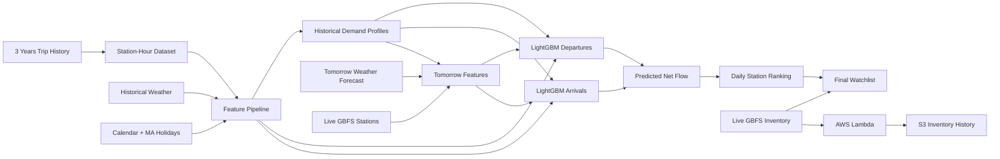

# Bluebikes Intelligence

**Next-day station demand forecasting and operational prioritization for Boston's Bluebikes network.**

Bluebikes Intelligence is an end-to-end applied machine learning project that forecasts hourly bike departures and arrivals for every active station, converts those forecasts into expected net bike depletion, and produces a ranked next-day station watchlist enriched with live inventory context.

> **Business question:** Which stations are expected to experience the greatest bike depletion tomorrow, and when should operations pay the most attention?

The system does **not** claim that a station will stock out or that a truck must be dispatched. Trip-based net depletion is an operational prioritization signal, not a confirmed inventory outcome.

---

## Why this project

A static demand forecast is not very useful to an operations team by itself. The goal here is to turn forecasting into a decision-support workflow:

```text
3 years of Bluebikes trips
        ↓
station-hour demand dataset
        ↓
calendar + holidays + weather + historical station behavior
        ↓
hourly departure and arrival forecasts
        ↓
predicted net flow
        ↓
daily station depletion ranking
        ↓
live inventory context
        ↓
next-day operational watchlist
```

The project also preserves an earlier live-inventory stockout experiment and AWS ingestion pipeline as complementary work.

---

## Key results

### Forecasting

The production-feasible model uses only information that can realistically be available before the forecast day: calendar features, Massachusetts/federal holidays, weather, and frozen historical station demand profiles.

| Model | Departures MAE | Departures WAPE | Arrivals MAE | Arrivals WAPE |
|---|---:|---:|---:|---:|
| Frozen historical profile baseline | 0.860 | 70.0% | 0.859 | 70.1% |
| LightGBM production model | **0.828** | **67.4%** | **0.824** | **67.2%** |

The ML model improves on the deployable historical-profile baseline while keeping the feature set available at prediction time.

### Operational ranking

On **92 unseen test days**, the predicted daily Top-10 watchlist captured:

- **4.04 of the actual Top-10 depletion stations per day on average**
- **40.4% average Top-10 hit rate**
- **40.0% median Top-10 hit rate**
- **1.7% expected Top-10 hit rate from random station selection**

This evaluates the output in the way an operations team would use it: as a ranked list of stations that deserve attention.

---

## Data

### Historical demand

The forecasting pipeline uses approximately **3 years of Bluebikes trip history (Sep 2023-Aug 2026)**.

The raw trip records are transformed into a station-hour dataset containing valid zero-demand periods.

Final historical dataset:

- **13,260,534 station-hour rows**
- **640 historical station IDs**
- hourly departures
- hourly arrivals

Raw and generated datasets are excluded from Git because of size.

### Weather and calendar

Features include:

- hour of day
- day of week
- month
- weekend indicator
- U.S. + Massachusetts holidays
- hourly temperature
- hourly precipitation

Historical experiments use observed weather. The real next-day workflow uses an actual weather forecast.

### Live station inventory

Bluebikes GBFS provides current station state. The final watchlist adds:

- current bikes available
- current docks available

Live inventory is **context**, not a forecasting target.

A separate AWS pipeline stores station-status snapshots every 10 minutes:

```text
Bluebikes GBFS
      ↓
Amazon EventBridge
      ↓
AWS Lambda
      ↓
Amazon S3
```

See `docs/cloud_inventory_pipeline.md`.

---

## Modeling approach

### 1. Build station-hour demand

Trips are aggregated into:

```text
station_id | datetime | departures | arrivals
```

Missing hours within observed active periods are represented as genuine zero-demand hours.

### 2. Establish a simple baseline

The first benchmark uses historical average demand by:

```text
station + weekday + hour
```

A model is only useful if it adds value over this simple rule.

### 3. Train LightGBM models

Departures and arrivals are modeled separately.

A research model showed that recent-demand lags improved performance, but those lagged trip counts are not available with sufficient freshness from the public trip archive.

The final production-feasible model therefore uses:

```text
calendar
weather
historical station demand profile
```

For stations without historical profiles, the system falls back to the network weekday/hour profile.

### 4. Evaluate chronologically

The project does not use a random train/test split.

```text
past data → training
later data → validation
future data → test
```

This better represents the real forecasting problem.

Primary metrics:

- **MAE** — average absolute trip-count error
- **WAPE** — total absolute error relative to total demand

The model is also evaluated separately on low-volume and busy stations.

### 5. Convert forecasts into an operations watchlist

For each station-hour:

```text
predicted_net_flow
= predicted_arrivals - predicted_departures
```

The system accumulates predicted net flow through the day and finds each station's point of greatest expected depletion.

The final output includes:

```text
station
predicted depletion
peak depletion time
current bikes
current docks
```

This is a prioritization tool, not a stockout guarantee.

---

## Architecture



---

## Repository structure

```text
bluebikes-intelligence/
├── README.md
├── PROJECT_PROBLEM.md
├── requirements.txt
├── docs/
│   ├── cloud_inventory_pipeline.md
│   └── modeling_decisions.md
├── infrastructure/
│   └── lambda/
├── notebooks/
│   └── 01_exploration_scratch.py
└── src/
    ├── ingestion/
    ├── data_pipeline/
    ├── forecasting/
    └── models/
```

### Forecasting module

The main workflow is in `src/forecasting/`:

```text
build_hourly_dataset.py
download_weather.py
build_features.py
build_demand_profile.py
production_model.py

download_tomorrow_weather.py
build_tomorrow_features.py
predict_tomorrow.py
final_watchlist.py
```

Historical evaluation scripts are retained separately in the same module for reproducibility.

---

## Run locally

Create and activate a Python environment, then install dependencies:

```bash
pip install -r requirements.txt
```

### Build historical features

```bash
python src/ingestion/download_trips.py
python -m src.forecasting.build_hourly_dataset
python -m src.forecasting.download_weather
python -m src.forecasting.build_features
python -m src.forecasting.build_demand_profile
```

Evaluate the production-feasible model:

```bash
python -m src.forecasting.production_model
```

### Generate tomorrow's watchlist

Run the complete next-day workflow with one command:

```bash
python -m src.forecasting.run_tomorrow
```

Or run the four stages individually:

```bash
python -m src.forecasting.download_tomorrow_weather
python -m src.forecasting.build_tomorrow_features
python -m src.forecasting.predict_tomorrow
python -m src.forecasting.final_watchlist
```

Generated data is written under `data/processed/` and is intentionally ignored by Git.

---

## Important modeling decisions

The project deliberately makes several conservative choices:

- uses chronological rather than random evaluation
- includes zero-demand station-hours
- compares ML against simple historical baselines
- separates departures and arrivals
- distinguishes historical observed weather from real forecast weather
- avoids deploying unavailable recent-trip lag features
- handles new stations with a network-level fallback profile
- treats net depletion as a prioritization signal, not a confirmed stockout
- preserves live inventory as operational context rather than mixing it into customer-trip demand

See `docs/modeling_decisions.md` for details and `docs/technical_walkthrough.md` for a compact technical explanation of the system.

---

## Current limitations

- Trip-based net flow does not include operator rebalancing.
- Current inventory today is not tomorrow morning's starting inventory.
- Historical backtests use observed weather rather than archived weather forecasts.
- Special events are not included in V1.
- The ranking identifies stations to monitor; it does not optimize truck routing or intervention decisions.
- Station network changes create cold-start cases for newly added stations.

---

## V2 ideas

Potential follow-up work:

- forecast-weather backtesting
- special-event features
- station-location features
- scheduled model refresh as new trip archives become available
- drift and forecast-quality monitoring
- comparison against additional operational ranking baselines
- routing optimization only after rebalancing labels become available

---

## Tech stack

**Python · Pandas · LightGBM · scikit-learn · Open-Meteo · Bluebikes GBFS · AWS Lambda · EventBridge · S3**

---

## Takeaway

The main lesson from this project is not that a complex model always wins.

A useful applied ML system needs:

1. a strong baseline,
2. realistic time-aware evaluation,
3. features that are actually available at prediction time,
4. an output tied to an operational decision,
5. honest limitations.

Bluebikes Intelligence turns hourly demand forecasts into a next-day station watchlist while keeping the distinction between **predicted customer demand**, **live inventory state**, and **confirmed stockouts** explicit.
