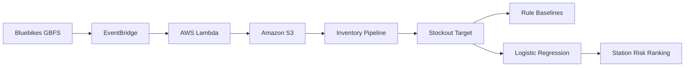

# Bluebikes Intelligence

**Predicting Bluebikes station stockouts 60 minutes ahead using live inventory data.**

Bluebikes Intelligence is an end-to-end applied ML project that collects live station inventory every 10 minutes, creates future stockout labels, evaluates prediction methods on future data, and ranks stations that may require rebalancing.

> **Question:** Given the current state of a station, will it run out of bikes within the next 60 minutes?

---

## Architecture



The AWS collector runs every **10 minutes**, storing raw Bluebikes station-status snapshots in S3.

---

## Prediction Target

The target is:

```text
stockout_next_60min
```

For each station observation:

```text
1  = station has bikes now and reaches 0 within 60 minutes
0  = station has bikes now and stays above 0 for 60 minutes
NA = station is already empty or insufficient future data exists
```

Stations already at zero are handled separately because the stockout has already happened.

---

## Features

V1 intentionally uses a small, interpretable feature set:

```text
num_bikes_available
previous_bikes
inventory_change
hour
day_of_week
```

Future inventory observations are used only to construct the target, not as model features.

---

## Time-Aware Evaluation

A random train/test split would leak time information because many stations share the same timestamps.

Instead, the project uses an out-of-time split:

```text
Historical observations
        ↓
TRAIN

60-minute gap
        ↓

Future observations
        ↓
TEST
```

This better represents the real deployment problem: train on the past and predict the future.

---

## Baseline Results

The ML model was compared with simple operational rules.

| Method | Precision | Recall |
|---|---:|---:|
| Bikes ≤ 1 | **15.8%** | 44.7% |
| Bikes ≤ 2 | 11.3% | 67.5% |
| Bikes ≤ 3 | 8.7% | 78.4% |
| Logistic Regression | 3.2% | **96.7%** |

Logistic regression detected:

```text
1,023 of 1,058 positive stockout-risk observations
```

but produced many false alerts.

### Key finding

The model achieves very high recall, but the simple low-bike rule is substantially more precise.

This means the first ML baseline has **not yet demonstrated enough operational value to replace the simpler rule**.

That result is intentionally preserved rather than hidden.

---

## Current Station Ranking

The latest snapshot is split into:

```text
Already at 0 bikes
        ↓
Current stockouts

Stations with bikes remaining
        ↓
Future stockout risk ranking
```

Example:

| Station | Bikes | Previous | Change | Risk Score |
|---|---:|---:|---:|---:|
| Forest River Park | 1 | 4 | -3 | 94.1% |
| N. Harvard St at Harvard Way | 1 | 3 | -2 | 93.2% |
| 175 N Harvard St | 1 | 2 | -1 | 92.2% |

A station falling from `4 → 1` bikes is ranked above one that remained at `1 → 1`.

Risk scores are used for ranking and should **not** be interpreted as calibrated probabilities.

---

## Project Structure

```text
bluebikes-intelligence/
│
├── docs/
│   └── cloud_inventory_pipeline.md
│
├── infrastructure/
│   └── lambda/
│       └── collect_station_status/
│
├── notebooks/
│   └── 01_exploration_scratch.py
│
├── src/
│   ├── ingestion/
│   ├── data_pipeline/
│   │   ├── inventory.py
│   │   └── model_data.py
│   └── models/
│       ├── logistic_baseline.py
│       ├── rule_baseline.py
│       └── risk_ranking.py
│
├── PROJECT_PROBLEM.md
├── requirements.txt
└── README.md
```

Raw and processed datasets are excluded from Git.

---

## Run Locally

```bash
git clone https://github.com/kcrokkam/bluebikes-intelligence.git
cd bluebikes-intelligence

python -m venv .venv
source .venv/bin/activate

pip install -r requirements.txt
```

The modeling pipeline expects Bluebikes station-status JSON snapshots under:

```text
data/snapshots/
```

Then run:

```bash
python -m src.data_pipeline.model_data
python -m src.models.logistic_baseline
python -m src.models.rule_baseline
python -m src.models.risk_ranking
```

The latest ranking is written to:

```text
data/processed/latest_station_risk.csv
```

---

## Current Limitations

V1 currently has a short live inventory history.

Other limitations include:

- no station-specific historical behavior yet
- no capacity or availability-ratio features
- no longer-window inventory trends
- no weather or event context
- risk scores are not probability calibrated
- repeated 10-minute alerts are evaluated as individual rows rather than operational episodes
- snapshot-gap validation can be improved

---

## Next Steps

The AWS pipeline will continue collecting data before additional model complexity is introduced.

V2 will focus on:

```text
More historical inventory
        ↓
Better station and trend features
        ↓
Stronger temporal validation
        ↓
Comparison against simple rules
        ↓
More complex models only if justified
```

Potential additions include station capacity, inventory trends, historical trip demand, weather, episode-level evaluation, probability calibration, and gradient-boosted trees.

---

## Tech Stack

**Python:** pandas, scikit-learn  
**Cloud:** AWS Lambda, EventBridge, S3  
**Data:** Bluebikes GBFS + historical trip data  
**Engineering:** Git, GitHub, GitHub Codespaces

---

## Takeaway

Bluebikes Intelligence demonstrates an end-to-end applied ML workflow:

```text
Live data
→ cloud ingestion
→ time-series dataset
→ future target
→ leakage-aware evaluation
→ baseline comparison
→ operational ranking
```

The most important V1 result is not simply the model's recall.

It is that the project tests whether ML actually adds value over a simple operational rule and uses that evidence to determine what should be built next.